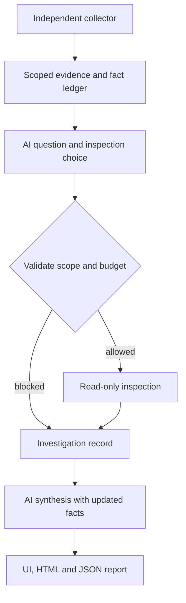

# Manager Report Readiness - Plan

## Goal Capsule

- **Objective:** A manager can use an independent prospect-URL report to decide what maintenance matters, who should act, and how the result will be checked.
- **Means:** Bounded agent investigation, evidence-led priorities and comparable repeat reports (KTD1–KTD5).
- **Authority:** Current user direction governs; `SPEC.md` remains the product reference. Verify the user-authorized SEO-capture and fact-ledger grounding fixes against their delivered commit before building this proposal; record that actual SHA during implementation.
- **Execution boundary:** This document proposes work; it does not authorize implementation, deployment, purchases or client-site remediation. The recommended agent architecture below awaits implementation authorization, not another prerequisite architecture interview.
- **Finish and ship:** Implementer proves each unit; Jax reviews the concrete result and selects the existing authorized host/access path before deployment. No implementation time estimate is assumed.

---

## Product Contract

### Summary

Build a bounded observe–choose inspection–execute–synthesize path for each independent agent, then present its result as a maintenance decision. Keep tested scope and reliability first, followed by evidence-linked priorities, comparisons and technical details.

### Problem Frame

Current reports mix scanner rows, review tasks, baselines and tool-completion counts in the same reading path. A manager must interpret those distinctions before deciding what to do. The historical Solvd AI text also demonstrates that valid evidence references alone do not establish supported factual claims. Better layout cannot compensate for unsupported agent conclusions.

Venu's November 4 demonstration asks for an independent customer URL producing commercially useful maintenance reports. He specifically points to unintended barriers, affected pages/templates, evidence and a specific correction or investigation. Jackie challenges whether ordinary testing alone constitutes an agent; that concern remains material. The broader nine-agent offering remains relevant; this plan addresses the first three agents and their reports, without redefining the offering as a generic score dashboard.

### Requirements

**Independent value and scope**

- R1. Each of Technical SEO & Discoverability, Accessibility Regression and Performance Regression must accept an eligible public URL independently, with no repository or other agent required.
- R2. A first run must produce useful scoped observations and an exportable baseline when supported, while compatible repeat runs distinguish measured change from uncertainty.
- R3. Preserve explicit pages, states, components, intent, owner priorities, release context and supplied evidence; absent optional inputs remain visible as absent.
- R4. Each agent must formulate an evidence-based question, choose an allowed inspection when useful and synthesize its result into a justified next action; the saved trace must show what the model contributed beyond scanner output.

**Trust and manager decisions**

- R5. Every count and conclusion must distinguish automated WCAG-tagged instances, best-practice instances, unresolved human checks, other observations and collection limitations.
- R6. The report must separate collection completion, observed site quality, AI availability, baseline compatibility and evidence retention; one must never substitute for another.
- R7. Every proposed priority must state what was observed, why it matters within the tested scope, affected location, suggested owner, next action, recheck and evidence basis; owner-supplied priorities remain distinct from suggestions.
- R8. Performance recommendations must identify recorded resources, elements or request chains when that evidence exists; audit labels or correlations alone cannot establish root cause, savings achieved or regression.
- R9. UI and offline HTML must communicate the same facts, categories, priorities, limitations and comparison outcomes; JSON and raw exports retain original evidence and provenance.
- R10. Bound model calls, inspection scope, resource use and cancellation through shared runtime policy; preserve public-network protections and measured results on failure, with no mocked AI or model-executed remediation.

### Acceptance Examples

- AE1. Covers R5–R7: the inspected Solvd accessibility report becomes “7 automated instances tagged to WCAG; 3 best-practice instances; 62 checks need human review.” The latter comprise 55 contrast checks and 7 video-caption checks, not 72 defects or 10 WCAG failures.
- AE2. Covers R6–R7: the SEO report with `__name` capture failure says rendered checks did not complete and assigns scanner investigation/rerun to the tool owner. Zero finding rows do not produce a clean-site claim or blame the target's JavaScript.
- AE3. Covers R2, R8: the first Solvd performance report states median 79/100 and LCP 3.01 s across 3/3 desktop navigation samples. The repeat states five metric comparisons inconclusive and CLS unchanged; LCP moving to 2.85 s is not a verified improvement.
- AE4. Covers R4, R7, R10: an unfamiliar URL produces a model-authored hypothesis/question, selected inspection and expected discriminating evidence, actual tool outcome, then synthesis that uses or explicitly qualifies that outcome. A second fixture with a different ambiguity must produce a materially different inspection or reasoned decision to stop; neither result is a renamed score summary.

### Scope Boundaries

The active proposal covers the first three agents' bounded investigation, report semantics, manager hierarchy, resource-specific evidence, interface/export parity and acceptance proof. The nine-agent direction remains unchanged.

#### Deferred to Follow-Up Work

The full nine-agent case/workflow platform, durable case orchestration, cross-agent routing, arbitrary browsing, new agents, scheduling, autonomous repairs, client-specific integrations and a new framework/hosting platform remain follow-up work. The commercial boundary remains monitoring/reporting first, with remediation separately authorized and quoted.

---

## Planning Contract

### Verified Starting Evidence

Implementation starting point: main `2f85f21`, SEO repair `ede589e` (published equivalent `6f194780`), and factual-grounding repair `127c943`. SEO GitHub CI passed 94/94 tests, typecheck and build. Grounding locally passed 33 focused tests, typecheck/build and 114/115 full-suite tests; the remaining loopback-listener test is blocked by the sandbox. Independent review and fresh provider/live acceptance for the grounding change remain separate gates. These fixes preserve generated AI analysis; neither implements the proposed investigation round.

These are inspected historical live reports with AI enabled, not proof that the current fixes have passed live acceptance. Their runtime files belong to the canonical checkout and are not committed fixtures.

| Evidence | Verified observation | Planning consequence |
|---|---|---|
| `.runs/run_0cf3fadbfb837dfaaa832517/report.json` | SEO partial; no findings; 8 complete, 2 incomplete, 1 not-configured coverage entries; `__name` diagnostic | Make collection gaps prominent (AE2) |
| `.runs/run_616c8d4405b85b716e814d20/report.json` | 1 button-name and 6 contrast WCAG-tagged instances; 3 best practices; 62 unresolved checks; 50 recorded focus steps | Show exact classes and sampled keyboard scope (AE1) |
| `.runs/run_044f6ac3345713a4951a05ae/report.json` | Performance median 79, LCP 3013.942 ms, 3/3 samples; generic audit-level review rows | Surface resource evidence without causal invention (AE3) |
| `.runs/run_53f2c26aab0422bcd172704e/report.json` | Compatible repeat; median 79; LCP 2852.3 ms; five metric changes inconclusive, CLS unchanged | Summarize uncertainty before numeric deltas |
| Sample-1 LHR artifact `art_d6f7f8273f31d88d260c9775` in the first performance run | Render-blocking `main.css` 53,671 bytes; CSS-to-font chain; image-delivery rows with selectors and estimated bytes | Normalize bounded actionable rows (U2) |

### Key Technical Decisions

- KTD1. **Extend existing renderers with tested semantic parity.** Keep DOM rendering in `public/app.js` and escaped offline HTML in `src/report.ts`, following the existing paired accessibility helpers and parity test (`public/app.js:292`, `src/report.ts:59`, `tests/report.test.ts:161`). Avoid introducing a framework or report-storage migration to solve a reading problem. Governs R5–R9.
- KTD2. **Derive the manager facts from report evidence.** Counts, scope, coverage and change status come from measured/supplied records, with explicit unknown classification. AI may interpret supported evidence under its separately accepted grounding contract; it cannot rewrite measurements. Governs R5–R7, R10.
- KTD3. **Retain bounded diagnostic details during collection.** Extend `auditDiagnostics` in `src/agents/performance.ts:116` to retain selected resource/element/chain rows and sample/artifact provenance, rather than making the browser parse raw LHR files or pretending old reports have missing detail. Governs R8–R9.
- KTD4. **Put the decision before the inventory.** Follow the visual hierarchy below, keeping technical IDs, runtime JSON, full focus sequences and raw scanner text available through disclosure. Governs R6–R9.
- KTD5. **Add one bounded investigation round with two model stages.** Initial observations feed an AI-authored question and allowed inspection choice; code validates/executes it; a final AI stage synthesizes the enriched fact ledger. This gives the model a substantive evidence-seeking role without restoring the full case platform. Follow `docs/research/05-Agent-Designs-and-Specifications.md:374` and `:392`, which specify bounded follow-up choice and investigation. Governs R1, R4, R7, R10.

These are implementation recommendations awaiting authorization. The smaller authorized grounding fix preserves generated analysis, hypotheses and proposals around a typed measured-fact ledger; it does not deliver follow-up inspection. Candidate-ranking-only was withdrawn. KTD5 deliberately proposes replacing the current one-call/no-tools mechanism in `SPEC.md`; those limits were engineering choices, not Venu's requirements.

### Proposed Visual Hierarchy

| Order | Visible content | Concrete example |
|---|---|---|
| 1 | Agent, exact URL/page/state scope, timestamp, headline conclusion | “Accessibility: review 7 WCAG-tagged automatic instances on this page” |
| 2 | Distinct facts and limitations | “3 best-practice instances · 62 human checks pending · initial state only” |
| 3 | First actions, with supporting evidence and suggested responsibility | “Developer: name the notification-bar close button; verify accessible name and operation, then rerun” |
| 4 | What changed or why change is unknown | “First baseline” or “5 metrics inconclusive; CLS unchanged” |
| 5 | Grouped affected locations and investigation details | Contrast selectors, displayed measured ratios where recorded, suggested recheck |
| 6 | Coverage, measurements, provenance, raw files and run configuration | Full distributions, 40 forward/10 backward focus steps, original IDs |

Action cards must keep fact, impact hypothesis, proposed intervention and verification visibly distinct (R7). An unnamed close button establishes a naming issue; inability to dismiss was not tested. A scanner-complete badge must not resemble a site-quality pass (R6).

### High-Level Technical Design

A justified “no further inspection” goes directly to synthesis. Inspection findings preserve original observation time and add inspection time; they are additive evidence and do not rewrite the initial collector result or resolve baseline findings automatically. Deterministic facts remain separate from unverified generated interpretation.

**Initial tools:** these inspect evidence already collected from accepted pages/states; they add no network navigation, scripts, interaction activation or repository access.

| Agent / proposed tool | Allowed input and useful result |
|---|---|
| SEO / inspect recorded page views | Existing page/state and source/render evidence IDs; return the paired directives, canonical, structured-data and applicable robots observations, including contradictions and missing views |
| Accessibility / inspect recorded element | Existing page/state, finding ID and recorded selector; return retained axe node HTML/check data, contrast measurements where present, related nodes and recorded focus evidence; never claim an unobserved activation or screen-reader result |
| Performance / inspect retained audit | Existing page/sample/audit/artifact IDs and recorded resource or element; return bounded LHR rows, dependency path or LCP breakdown, with resource identity, units and estimated-versus-measured labels |

**Proposed technical defaults, not approved limits:** at most two model calls and two serial inspections in one round, no provider retries, 45 seconds per model stage, 1,200 output tokens for choice and 2,200 for synthesis. These bound cost while allowing selection plus reconsideration. Use at most 32 KiB transmitted context per stage and 8 KiB output per inspection, with exact omissions recorded. Parse at most 2 MiB of an already-retained JSON artifact, depth six and eight selected rows per result; report larger/unsupported detail as inconclusive rather than silently treating it as absent.

Create a 100-second post-collection investigation deadline and combine it with the caller's abort signal; never extend a shorter caller deadline. The current `runAgent` does not itself establish a whole-run deadline. Inspectors check the combined signal before dispatch and during bounded traversal. No extra browser/worker dispatch is needed for this first tool set: local and GitHub collectors already return evidence/artifact bytes to `runAgent`. All inputs resolve through run-owned IDs, never file paths, arbitrary URLs or invented selectors. A request to revisit a page, activate a control or inspect an uncollected target is blocked and becomes missing evidence; a future network inspector requires the same DNS-pinned egress, origin validation, request/byte budgets and browser lane, not direct `fetch`.

Each investigation records the model's question/hypothesis, requested tool/arguments and supporting fact IDs, validation result, executed inspection, returned evidence IDs and `blocked` or `inconclusive` outcome/reason. Requested and executed work remain distinguishable. A tool error, omission, timeout, injection attempt or denied request cannot become a target defect. Provider failure preserves measured facts and inspection records; generated synthesis remains unavailable or explicitly unverified, never replaced with mock reasoning.

### Assumptions and Rollout

- **Proposed default:** show up to three first actions, then the full grouped queue. Suggested roles such as developer, content owner and QA describe responsibility, not assignments to real people.
- **Unvalidated usability target:** a manager should identify the first action, location, suggested owner and limitation without opening technical disclosures. Confirm this through the U5 walkthrough rather than claiming it from screenshots.
- **Recommended architecture:** KTD5 is concrete enough to plan now. Implementation awaits authorization; its two-stage behavior must pass AE4 before an agent-readiness claim.
- **Implementation-time details:** final diagnostic row caps must fit existing evidence, remote artifact and AI payload budgets; unsupported Lighthouse detail variants must disclose omission. KTD5's additional model stage is a proposed contract change; no new service is needed.
- **Rollout gate:** a persistent reviewer URL, exact deployed commit, storage behavior and intended access remain unverified. Host/access choice is needed only after the local result is concrete and reviewable.

### Dependencies and Impact

Build on the user-authorized SEO source-worker and measured-fact-ledger fixes, recording their actual verified commit. Their internal execution notes are not long-term product authority; `SPEC.md` owns the resulting contract. The main cross-interface risk is semantic drift between DOM, HTML, JSON and historical reports. Diagnostic detail raises payload volume and untrusted-text exposure, so keep existing escaping, caps and generated artifact IDs.

---

## Implementation Units

### U1. Establish manager-facing facts and classifications

**Goal / Requirements:** make every headline and action use the exact report category and scope (R2, R5–R7). **Dependencies:** verified user-authorized fact-ledger grounding fix.
**Files:** `public/app.js`, `src/report.ts`, `tests/report.test.ts`, `tests/demo-ui.test.ts`; add sanitized report fixtures under `tests/fixtures/manager-reports/`.
**Approach:** extend `headlineMetrics`, `accessibilityGroups`, `emptyFindingsSummary` and comparison summaries per KTD1–KTD2. Preserve distinct owner-priority and suggested-priority labels; unknown tags stay unknown. Start with characterization fixtures derived from the inspected failures.
**Test scenarios:**
1. Covers AE1: mixed WCAG/best-practice/manual rows give exact separate counts, including unknown classifications and no double-counting.
2. Covers AE2: failed, partial and complete zero-finding reports produce different scoped conclusions; optional absent inputs are not defects.
3. Covers AE3: first-run, incompatible, incomplete and noisy comparisons produce honest headlines; collection completion cannot supply a quality grade.
**Verification:** paired live/export semantic assertions match, measured report objects are unchanged, and legacy reports remain readable.

### U2. Preserve actionable performance diagnostics

**Goal / Requirements:** replace generic audit-only investigation with evidence naming the implicated resource or element (R7–R9). **Dependencies:** none; U3 consumes the result.
**Files:** `src/agents/performance.ts`, `tests/performance.test.ts`, `tests/report.test.ts`; new sanitized LHR detail fixtures in `tests/fixtures/manager-reports/`.
**Approach:** per KTD3, normalize supported render-blocking table rows, image-delivery resource/selector rows, LCP breakdown/element detail and bounded network-tree paths. Retain page, sample, audit and artifact references; preserve numeric units and estimated-versus-measured labels. Do not infer shared components, removed requests, causal fixes or additive savings across samples.
**Test scenarios:**
1. A retained render-blocking/image row yields the exact resource, selector if supplied, bytes and estimated savings, linked to its sample.
2. Nested network-tree/LCP details retain a bounded path or breakdown without claiming that a named asset caused the measured LCP.
3. Missing/changed detail shape, malformed values, excessive nesting or truncation leaves honest omissions and usable metric distributions.
4. Malicious resource strings render as text; missing historical details yield “resource detail unavailable” and existing raw-artifact access.
**Verification:** supported fixtures retain useful detail within budgets; raw artifacts and baseline identity/comparison semantics remain intact.

### U7. Implement the three scoped inspection adapters

**Goal / Requirements:** give each agent concrete evidence-seeking capability rather than a predefined recommendation menu (R4, R5, R8, R10). **Dependencies:** existing collector results; U2 supplies normalized performance details.
**Files:** new `src/agents/seo-inspection.ts`, `src/agents/accessibility-inspection.ts`, `src/agents/performance-inspection.ts`, `tests/inspection-tools.test.ts`; extend `tests/seo.test.ts`, `tests/accessibility.test.ts`, `tests/performance.test.ts` and sanitized `tests/fixtures/manager-reports/` inputs.
**Approach:** implement only the initial tools and bounds above. Resolve run-owned evidence/artifact IDs in memory, select recorded page/state/selector/resource targets and return typed facts plus omissions. Treat all site text as data; no tool accepts code, filesystem paths or network destinations.
**Test scenarios:**
1. SEO source/render disagreement returns both recorded views; unknown intent, missing render and scanner failure support investigation without claiming an indexing defect or shared template cause.
2. Accessibility contrast/related-node inspection preserves the actual selector, ratio and incomplete reason; absent-name plus focus evidence cannot establish dismissal failure, and best practices cannot become WCAG defects.
3. Performance inspection returns the exact selected CSS/font chain or image resource and estimated saving; a different LCP element cannot be silently attributed to that image.
4. Wrong-run artifact, invented selector, oversized/malformed/missing raw JSON, excessive depth and abort yield blocked/inconclusive records within bounds; unchanged historical reports remain readable.
**Verification:** all three adapters run without additional network access, operate on both local and returned worker artifacts, and yield facts the final model can cite without fabricating missing measurements.

### U6. Add bounded evidence-seeking agent orchestration

**Goal / Requirements:** implement substantive, traceable model choice and synthesis (R1, R4, R7, R10). **Dependencies:** verified user-authorized fact-ledger grounding fix; U7 supplies inspectors.
**Files:** new `src/core/investigation.ts`, `tests/investigation.test.ts`; extend `src/core/assessment.ts`, `src/core/assessment-grounding.ts`, `src/core/types.ts`, `src/run.ts`, `tests/assessment.test.ts`, `tests/run.test.ts` and `SPEC.md`.
**Approach:** implement KTD5 around the accepted fact ledger. Separate observation facts, generated hypotheses/inspection requests, code-produced inspection evidence and final interpretation. Validate typed requests before execution and validate final references against exactly transmitted facts. Generated rationale and novel investigation proposals remain model-authored and unverified; syntactic/reference checks do not establish universal semantic truth. Share orchestration through `runAgent`, CLI and API; preserve standalone collectors and immutable baseline inputs.
**Test scenarios:**
1. Covers AE4: two ambiguous fixtures select materially different inspections; the final synthesis cites actual returned facts and updates or withholds the initial hypothesis.
2. A clean result can justify stopping without tools; unsupported target/selector/tool, malicious evidence instructions and fabricated fact references execute nothing and remain recorded.
3. First/final provider failure, blocked/inconclusive tool, exhausted context/deadline and cancellation preserve measured results and truthful provenance with no retry or mock fallback.
4. Local/remote collector results produce equivalent orchestration and bounded artifacts; follow-up evidence cannot falsely resolve prior findings or alter original comparison coverage.
**Verification:** recorded requested/executed/blocked/inconclusive traces match actual behavior, budgets hold, and independently invoking each agent needs no other agent or client repository.

### U3. Render the manager decision hierarchy

**Goal / Requirements:** expose a clear first decision and complete supporting queue in desktop, mobile and HTML reports (R5–R9). **Dependencies:** U1, U2, U6, U7.
**Files:** `public/app.js`, `public/styles.css`, `src/report.ts`, `tests/report.test.ts`, `tests/demo-ui.test.ts`.
**Approach:** apply KTD4 to overview, first-action cards, comparison summary and evidence disclosures. Prioritize accepted evidence-grounded recommendations with visible source; use deterministic finding guidance when AI is unavailable, clearly labeled. Show the investigation question, outcome and evidence beneath each generated action; preserve historical AI-draft disclosure and explicit unverified-interpretation labeling.
**Test scenarios:**
1. Covers AE1–AE3: each report exposes conclusion, first action and uncertainty before raw inventory in both renderers.
2. An action shows observation, affected location, suggested role, next step, recheck and evidence; collection repair is assigned to the tool owner.
3. Empty actions, unavailable AI, legacy AI, no baseline and multi-page results show explicit states without inventing recommendations or site-wide conclusions.
4. Keyboard users can open every disclosure and reach evidence anchors; narrow screens retain all action fields without document-level horizontal overflow.
**Verification:** rendered desktop/mobile and offline HTML agree on category, priority source, location, counts and limitations; the first decision does not require reading IDs or JSON.

### U4. Preserve repeat, history and export workflows

**Goal / Requirements:** retain the operational workflow that turns a report into recurring maintenance evidence (R1–R3, R9–R10). **Dependencies:** U3.
**Files:** `public/app.js`, `tests/demo-ui.test.ts`, `tests/run.test.ts`, `tests/report.test.ts`; `src/server.ts` only for a proven export integration gap.
**Approach:** retain `restoreRunInputs`, saved-run URL loading, baseline import/use, downloads and stale-request protection. Add behavior tests around the changed reports; do not add a dashboard or new persistence system.
**Test scenarios:**
1. Load a saved run, preserve agent/URL/configured input, then rerun with an explicit compatible baseline and download matching JSON/HTML/baseline.
2. Wrong baseline, invalid target/import, missing saved run, failed retention or missing raw artifact produces the applicable explanation and no false saved/compared claim.
3. Interrupted request or stale response keeps the previous report labeled as previous and prevents it from appearing to verify the requested new run.
**Verification:** per-agent independence and existing input/network constraints remain unchanged; exports and restored reports communicate the same run.

### U5. Prove agent value and manager readiness

**Goal / Requirements:** demonstrate R1–R4 and R10 with actual execution, then check the manager outcome. **Dependencies:** U1–U4, U6, U7.
**Files:** extend `tests/assessment.test.ts`, `tests/run.test.ts` and `tests/demo-ui.test.ts` as needed; add an explicit opt-in live acceptance script under `scripts/`; update `README.md` and the existing issue #1 evidence record.
**Approach:** record offline, fixture, live, visual and deployment proof separately. Use Solvd as the preferred demonstration, plus another eligible public page, and evaluate each agent independently through its normal URL entry point. For AE4, inspect the actual input, reasoning contribution, evidence references and output rather than treating a successful model request as sufficient proof.
**Test scenarios:**
1. Each agent produces a useful first report and a real successful grounded AI result; unavailable/rejected AI preserves measured evidence.
2. Controlled known-change, clean, partial, invalid-target and compatible/incompatible-baseline cases demonstrate truthful classifications; missing state coverage never becomes resolved.
3. Manager walkthrough identifies a concrete next action, rationale, location, suggested owner and recheck from each report; record confusion and amend presentation before approval.
4. The approved runtime serves the exact reviewed commit; intended reviewer access, saved-report reload, export availability and retention behavior are verified without weakening protections.
**Verification:** retain run IDs and exact evidence for each passed criterion; runtime or access gaps remain named blockers rather than completion claims.

---

## Verification Contract

Source grounding: [November 4 original meeting and continuation](https://chatgpt.com/library?file_id=libfile_c1fa276ccb348191a81a86dc36271785&account_id=personal), especially the URL/report and reviewed-technical-report discussion at lines 69–99 and modularity continuation at lines 118–138; [August 7 original service discussion](https://chatgpt.com/library?file_id=libfile_77fe36216a3881919de6493ca20fe751&account_id=personal), line 23; [context reconciliation](https://chatgpt.com/library?file_id=libfile_80be66e5d6cc819186775bd7f5583403&account_id=personal), lines 31–48, treated as secondary to the meetings and inspected code.

| Gate | Units | Required evidence |
|---|---|---|
| Focused characterization and contracts | U1–U4, U6–U7 | New scenarios in named test files, including live/export parity and historical compatibility |
| Repository checks | U1–U7 | Fresh `npm run typecheck`, `npm test`, `npm run build` results; distinguish environment failures from code failures |
| Browser review | U3–U4 | Desktop and narrow mobile screenshots plus keyboard/disclosure/anchor checks on the actual rendered interface and HTML export |
| Independent live acceptance | U5 | Per-agent Solvd and second-page runs, actual provider/model/usage evidence and first/repeat/failure proof |
| Manager review | U5 | Observed walkthrough against the Objective, with unresolved confusion recorded |
| Delivery | U5 | Authorized host/access choice, deployed commit, reachable reviewer URL and retention/export proof |

No tests, new live collection or deployment were run to write this plan. Existing tests were read as patterns, not reported as fresh passing proof. There is no `release:validate` script in the inspected package.

---

## Definition of Done

U6–U7 prove actual bounded inspection choice, execution and synthesis against AE4. U1–U4 meet their listed scenarios and the three report formats preserve evidence truth. U5 establishes the actual agent contribution and demonstrates that a manager can act from the reports. All applicable verification gates have recorded outcomes, and abandoned experimental code is removed. Deployment and overall manager readiness remain incomplete until their explicit gates pass; a local build, corrected screenshot or live model response alone cannot close them.
